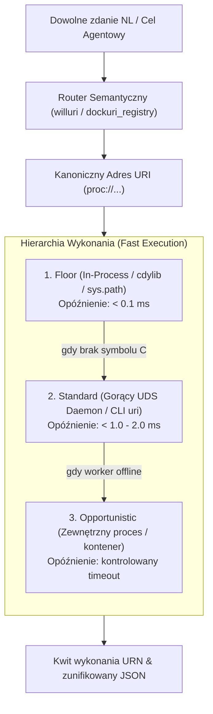

# Wellmanifest Dockuri Standard (DOCK-STD-001)

Version: `0.1.0`  
Status: `PROPOSED / ACTIVE`  
Normative Reference: `wellmanifest/dockuri`  
Complementary Standards: [`wellmanifest/apx`](https://github.com/wellmanifest/apx), [`wellmanifest/uriprocess`](https://github.com/wellmanifest/uriprocess), [`wellmanifest/poa`](https://github.com/wellmanifest/poa)

---

## 1. Cel i zasady architektoniczne

Standard **Dockuri** definiuje protokół ultra-szybkiego wywoływania i łączenia w potoki (pipelining) pojedynczych funkcji i procedur pochodzących z heterogenicznych projektów (Python, JavaScript/TypeScript, Rust, PHP, Go, C/C++) bez ponoszenia kosztów zimnego startu kontenerów czy procesów.

### Zasady nadrzędne:
1. **Zero Cold-Start (< 2.0 ms latency)**: Wywołanie funkcji z dowolnego projektu musi odbywać się przez gorącego demona (pre-warmed worker daemon) za pośrednictwem lokalnego gniazda uniksowego (**Unix Domain Socket - UDS**) lub pamięci operacyjnej, eliminując opóźnienia `docker run` czy ponownego startu interpretera.
2. **Zero-Copy dla dużych ładunków**: Dane powyżej 64 KB (obrazy, audio, wektory, pliki binarne) nie są serializowane w JSON/NDJSON, lecz przekazywane za pomocą deskryptorów pamięci współdzielonej (`/dev/shm` lub `mmap`).
3. **Determinizm i Audytowalność**: Każde wywołanie procedury generuje jednoznaczny identyfikator, a cały potok funkcji (pipeline DAG) generuje zbiorczy kwit wykonania (**CompositeExecutionReceipt** zgodny z `wellmanifest.wellman/receipt/v1`).
4. **Językowa poligloticzność**: Klient Dockuri może w jednym łańcuchu połączyć funkcję w Rust z funkcją w Pythonie i funkcją w Node.js bez wiedzy o ich wewnętrznych stosach technologicznych.

---

## 2. Reguły normatywne

### `DOCK-MAN-001: Procedure Manifest Contract`
Każdy projekt włączany do siatki Dockuri musi posiadać w swoim korzeniu plik [`dockuri.json`](schemas/dockuri-manifest.schema.json).
Manifest musi określać:
* `$schema`: URL schematu `https://wellmanifest.org/schemas/dockuri-v1.json`.
* `app`: Identyfikator aplikacji/projektu (np. `taskand`, `faktury`, `base64`).
* `version`: Wersja semantyczna semver.
* `transport`: Domyślny transport IPC (UDS, stdio, http) ze ścieżką do gniazda socket.
* `procedures`: Słownik eksportowanych procedur, ich schematy wejścia/wyjścia (JSON Schema) oraz deklarację efektu ubocznego (`effect: pure | idempotent | mutating`).

### `DOCK-IPC-001: IPC Protocol Envelope`
Komunikacja pomiędzy orkiestratorem Dockuri a workerem odbywa się za pomocą ramek **NDJSON** (Newline Delimited JSON) kodowanych w UTF-8, przesyłanych przez strumień UDS lub stdio.

#### Ramka żądania (Request):
```json
{
  "id": "req-98fbc12a",
  "proc": "base64.encode",
  "args": { "text": "hello world" },
  "ctx": { "trace_id": "tr-001", "timeout_ms": 500 },
  "shm": null
}
```

#### Ramka odpowiedzi (Response):
```json
{
  "id": "req-98fbc12a",
  "ok": true,
  "result": { "encoded": "aGVsbG8gd29ybGQ=" },
  "error": null,
  "metrics": { "duration_us": 85 }
}
```

### `DOCK-UDS-001: Unix Domain Socket Path & Permissions`
1. Ścieżka do gniazda uniksowego jest wyznaczana według hierarchii:
   * Zmienna środowiskowa `DOCKURI_SOCKET`.
   * Zmienna środowiskowa `DOCKURI_RUN_DIR/<app>.sock`.
   * Standardowa ścieżka systemowa `/run/dockuri/<app>.sock` (jeśli proces ma uprawnienia zapisu).
   * Ścieżka użytkownika `~/.dockuri/run/<app>.sock`.
2. Plik gniazda musi posiadać uprawnienia `0660` (lub `0600`), umożliwiając dostęp uprawnionym procesom użytkownika lub grupy wykonawczej.

### `DOCK-SHM-001: Zero-Copy Shared Memory Protocol`
1. Dla ładunków przekraczających 64 KB (np. wideo, dźwięk, ramki graficzne, tablice numpy/safetensors) dane są umieszczane w pamięci RAM `/dev/shm/dockuri/<buffer_id>`.
2. W ramce IPC pole `shm` przyjmuje strukturę:
```json
{
  "shm": {
    "path": "/dev/shm/dockuri/buf-4412.raw",
    "offset": 0,
    "size": 1048576,
    "format": "raw/bytes"
  }
}
```
3. Worker mapuje pamięć do swojej przestrzeni adresowej za pomocą `mmap` i zwraca wynik również w buforze SHM bez kopiowania danych do pętli JSON.

### `DOCK-LFT-001: Auto-Spawn and Graceful Fallback`
1. W przypadku, gdy żądany socket UDS nie istnieje lub demon nie odpowiada:
   * Klient Dockuri sprawdza dyrektywę `transport.auto_spawn` w `dockuri.json`.
   * Jeśli flaga jest włączona (`true`), klient jednorazowo uruchamia polecenie z `transport.spawn_cmd` w tle (demonizuje) i czeka do 500 ms na gotowość gniazda.
   * W razie braku możliwości uruchomienia demona, klient stosuje `fallback` zdefiniowany w manifeście (`native` lub `http`).

### `DOCK-PNG-001: System Ping & Latency Budget`
Każdy zgodny worker Dockuri **musi** implementować wbudowaną procedurę systemową `__ping__`:
* Żądanie: `{"id": "...", "proc": "__ping__", "args": {}}`
* Odpowiedź: `{"id": "...", "ok": true, "result": {"status": "pong", "runtime": "cpython-3.11", "uptime_s": 1420}}`
* Budżet czasowy: Czas round-trip żądania `__ping__` przez UDS **nie może przekraczać 2.0 ms** (wymóg testu zgodności).

### `DOCK-PIP-001: Pipeline Composition & Composite Execution Receipt`
1. Dockuri umożliwia łączenie procedur w deklaratywny graf DAG:
```json
{
  "pipeline": "process_invoice",
  "stages": [
    { "step": 1, "use": "proc://base64.decode", "input": "$input.raw_pdf" },
    { "step": 2, "use": "proc://ocr.extract_text", "input": "$stages.1.result" },
    { "step": 3, "use": "proc://faktury.parse_nip", "input": "$stages.2.result" }
  ]
}
```
2. Wynik wykonania całego potoku jest autoryzowany jednym kwitem wykonania (**CompositeExecutionReceipt**) zawierającym skróty kryptograficzne każdego etapu bez narzutu dyskowego $O(1)$.

### `DOCK-REG-001: Procedure Registry Discovery & Content-Addressed Indexing`
1. Rejestr procedur Dockuri (`dockuri_registry.py`) indeksuje wszystkie deklaracje `dockuri.json` w workspace w sposób statyczny i deterministyczny:
   * **Adresowalność kanoniczna**: Każda procedura otrzymuje niezmienny identyfikator URI `proc://<app>/<proc_path>/<version>`.
   * **Skrót kontraktu (`contract_digest`)**: Deterministyczny hash SHA-256 z kanonicznego JSON schematu i metadanych procedury. Zmiana parametrów powoduje unieważnienie skrótu i odświeżenie indeksu.
   * **Brak efektów ubocznych przy indeksacji**: Skaner odczytuje wyłącznie pliki JSON/YAML; nie wykonuje kodu projektu, nie uruchamia procesów potomnych.

### `DOCK-NL-001: Semantic Retrieval & Constrained NL Pipeline Synthesis`
Integracja poleceń w języku naturalnym (NL Control Command) z rejestrem procedur Dockuri przebiega w 3-etapowym cyklu:
1. **Dwuetapowa projekcja kandydatów (Candidate Projection)**:
   * Wyszukiwarka rejestru filtruje zbiór tysięcy procedur za pomocą hybrydowego wyszukiwania leksykalno-semantycznego (FTS5 + embeddings) i wybiera wyłącznie ograniczony zbiór Top-K (np. 5–8) kandydatów pasujących do polecenia NL.
2. **Gramatyka sterowana (Constrained Generation)**:
   * Wybrani kandydaci są rzutowani na format narzędzi LLM (OpenAI Tool Calls / MCP) lub gramatykę GBNF (`root ::= "{" "proc": ... "args": ... "}"`), uniemożliwiając modelowi wygenerowanie nieistniejących parametrów lub halucynowanych URI.
3. **Kompilacja do potoku wykonawczego**:
   * Model syntetyzuje deklaratywny plan potoku (`wellmanifest.nl-plan/v1`), który jest natychmiastowo przekazywany do silnika wykonawczego `dockuri_client.py` i wykonywany przez gorące demony UDS w czasie poniżej 1–2 ms.

### `DOCK-FLOW-001: Workflow DAG and Data Flow Standard (dockuri/workflow-v1)`
Końcowym standardem zapisu potoku wygenerowanego przez model LLM lub operatora jest schemat **`dockuri/workflow-v1`** ([`schemas/dockuri-pipeline.schema.json`](../schemas/dockuri-pipeline.schema.json)):

```json
{
  "$schema": "https://wellmanifest.org/schemas/dockuri-pipeline-v1.json",
  "name": "verify_and_digest_version_artifact",
  "max_parallel": 4,
  "flow": [
    {
      "id": "step1_read_file",
      "uri": "proc://urirun-connector-fs/fs/read_text/v1",
      "input": { "path": "/path/to/VERSION" }
    },
    {
      "id": "step2_encode_b64",
      "uri": "proc://urirun-connector-base64/base64/encode/v1",
      "depends_on": ["step1_read_file"],
      "input": {
        "text": { "$from": "step1_read_file", "path": "/content" }
      }
    },
    {
      "id": "step3_classify",
      "uri": "proc://curi/curi/classify_uri/v1",
      "depends_on": ["step2_encode_b64"],
      "input": { "uri": "fs://host/file/query/version" }
    }
  ]
}
```

#### Wymagania normatywne przepływu danych:
1. **Identyfikacja etapów (`id`)**: Każdy etap musi posiadać unikalny w skali grafu identyfikator dopasowany do wzorca `^[a-zA-Z0-9_-]+$`.
2. **Kierunek przepływu danych (`$from`)**: Odwołania do wyników poprzednich etapów realizowane są ściśle za pomocą standardu **RFC 6901 JSON Pointer** ze strukturą:
   `{"$from": "<poprzedni_krok>", "path": "/ścieżka/do/pola"}`.
3. **Jawność zależności (`depends_on`)**: Każde użycie referencji `{"$from": "stepA", ...}` **musi** być zadeklarowane w tablicy `depends_on: ["stepA"]`.
4. **Weryfikacja acykliczności DAG**: Przed wykonaniem orkiestrator sprawdza graf algorytmem Kahna. Wykrycie cyklu zatrzymuje wykonanie ze statusem błędu (*fail-closed*).
5. **Kwit kryptograficzny**: Każdy krok generuje hash stanu pośredniego, a po zakończeniu emitowany jest jeden zbiorczy kwit `CompositeExecutionReceipt` (`wellmanifest.wellman/receipt/v1`).

### `DOCK-URI-001: Universal Polyglot URI Invocation Contract (uri('') & uri <address> + JSONL)`
Aby wyeliminować duplikację skryptów pomocniczych w skali wszystkich projektów, każdy skrypt lub moduł w dowolnym języku linkuje do zunifikowanego interfejsu wywołania procesów URI:

1. **Interfejs biblioteczny `uri('<pełny_adres_uri>', [payload])`**:
   * Przyjmuje pełny adres URI wraz z opcjonalnymi parametrami zapytania (`proc://app/module/action/v1?dry_run=true`) oraz ładunek słownikowy, JSON, wieloliniowy strumień **JSONL** lub referencję plikową `@plik.jsonl`.
   * Dla pojedynczego rekordu zwraca słownik wyniku `dict[str, Any]`; dla wsadu JSONL (wielu linii lub listy obiektów) zwraca listę wyników `list[dict[str, Any]]`.
   * Funkcja `uri_jsonl('<pełny_adres_uri>', lines)` przetwarza strumień linii JSONL w sposób leniwy/wsadowy.
2. **Uniwersalna komenda CLI `uri <pełny_adres_uri> [jsonl]`**:
   * Wywołanie z argumentem: `uri 'proc://system/sprint/deduplicate/v1' '{"project":"/path","dry_run":true}'`
   * Wywołanie ze strumieniem JSONL na `stdin`:
     ```bash
     printf '%s\n' '{"project":"/repo/a"}' '{"project":"/repo/b"}' | uri 'proc://system/sprint/deduplicate/v1?dry_run=true'
     ```
   * Wywołanie z plikiem JSONL: `uri 'proc://system/sprint/deduplicate/v1' @targets.jsonl`
3. **Poliglotyczne generowanie wiązań (`--snippet <lang>`)**:
   * Komenda `uri --snippet <python|bash|js|rust|go|php> <pełny_adres_uri>` oraz funkcja `render_uri_call_snippet(...)` generują minimalny kod linkujący w docelowym języku, zastępujący lokalne duplikaty skryptów wywołaniem procesu URI w `dockuri`.

### `DOCK-LFC-001: Declarative URI Process Lifecycle & Cross-Project Deduplication (proc://system/process/manage/v1)`
Procesy URI są centralnie generowane, modyfikowane i przenoszone (relokowane) za pomocą metaprocesu `proc://system/process/manage/v1`:
1. **`action=generate | modify | upsert`**: Rejestruje lub aktualizuje proces `dockuri/proc-v2` w manifeście `dockuri.yaml` wraz z wygenerowanymi snippetami poliglotycznymi (`python`, `bash`, `js`, `rust`) i kwitem `receipt_urn`.
2. **`action=relocate | move | rename`**: Przenosi definicję procesu URI pomiędzy manifestami projektów lub zmienia jego kanoniczny adres URI z zachowaniem ciągłości audytowej (poprzedni adres trafia do `aliases`).
3. **`action=snippet`**: Zwraca gotowy kod wywołania `uri('<target_uri>', ...)` dla wybranego języka.

### `DOCK-PRM-001: Normative Generic Prompts & URI-First Enforcement`
Standard `wellmanifest/dockuri` **wymusza** stosowanie podejścia *URI-First* zarówno na poziomie walidatora (`dockuri_check.py --check-uri-standard`), jak i na poziomie zunifikowanych promptów generycznych (`GENERIC_URI_PROMPTS` w `dockuri_llm_pipeline.py`):

1. **Wymuszenie w walidatorze (`dockuri_check.py`)**:
   * Walidator sprawdza poprawność katalogu `dockuri/proc-v2` (`dockuri.yaml`), unikalność kanonicznych adresów `uri` oraz ciągłość aliasów (`aliases`) po relokacji (`DOCK-LFC-001`).
   * Walidator weryfikuje dostępność kontraktu `uri()` / `uri_jsonl()`, obecność metaprocesu `proc://system/process/manage/v1` oraz kompletność normatywnych szablonów promptów generycznych (`DOCK-PRM-001`).
2. **Wymagane szablony promptów generycznych (`GENERIC_URI_PROMPTS`)**:
   * `system_uri_first` — generyczna instrukcja systemowa nakazująca agentowi sprawdzenie katalogu `uri --catalog` przed napisaniem nowego skryptu pomocniczego i wywoływanie istniejących procesów przez `uri('<adres>', payload)` lub `uri_jsonl('<adres>', lines)`.
   * `discover_and_run` — generyczny prompt odkrywania i uruchamiania procesu URI dla dowolnego zadania w repozytorium.
   * `extract_to_dockuri` — generyczny prompt ekstrakcji powtarzalnej logiki z dowolnego pliku do centralnego procesu w `dockuri` (`action="generate"` w `proc://system/process/manage/v1`) i zastąpienia duplikatu wywołaniem `uri(...)`.
   * `modify_and_relocate` — generyczny prompt modyfikacji i przenoszenia procesu URI pod nowy adres (`action="relocate"`) z zachowaniem kompatybilności wstecznej przez `aliases`.
   * `batch_jsonl_stream` — generyczny prompt wsadowego przetwarzania wielu celów/repozytoriów strumieniem JSONL (`uri <adres> + JSONL` / `uri_jsonl`).
   * `streamline_remediate` — generyczny prompt naprawy długu architektonicznego i złożoności cyklomatycznej z użyciem deskryptorów `uriDelegation` oraz diagnostyki `proc://system/self-improvement/diagnose/v1`.
   * `project_sentence_dispatch` — generyczny prompt wywołania dowolnego zdania lub polecenia w języku naturalnym na bazie dowolnego projektu uruchamialnego przez Dockuri.

### `DOCK-DISP-001: Universal NL Sentence Dispatch on Any Dockuri-Runnable Project`
Standard **Dockuri** definiuje procedurę mapowania i wykonywania dowolnego zdania w języku naturalnym (PL/EN) na bazie dowolnego projektu w organizacji, który posiada deskryptor uruchomieniowy Dockuri:

1. **Definicja projektu uruchamialnego przez Dockuri (Dockuri-Runnable Project)**:
   Projekt jest uznawany za uruchamialny przez Dockuri, jeśli w jego strukturze znajduje się co najmniej jeden ze standardowych deskryptorów:
   * `dockuri.yaml` / `dockuri.yml` w standardzie `dockuri/proc-v2` (lista procedur `processes` z komendami `run` i aliasami).
   * `dockuri.json` w standardzie `dockuri-v1` (deklaracja procedur `procedures` i transportu IPC UDS).
   * `.dockuri/dockuri.yaml` lub `.dockuri/dockuri.json` (lokalny deskryptor pomocniczy w repozytoriach zewnętrznych).
   * `apx.yaml` lub `connector.manifest.json` (urirun connector).
   * Zarejestrowana usługa w indeksie `DockuriRegistry`.
   Walidator `dockuri_check.py --project <ścieżka>` automatycznie wykrywa typ deskryptora i listę dostępnych procedur.

2. **Dwuetapowy cykl wywołania zdania (Sentence Dispatch Cycle)**:
   * **Etap 1: Dopasowanie semantyczne / Routing**:
     Dowolne zdanie języka naturalnego $S$ (np. *„Zdeduplikuj zadania w sprincie w semcod/tagi”*, *„Sprawdź spójność bazy danych”*, *„Uruchom testy jednostkowe w willuri”*) jest analizowane przez router semantyczny (`willuri` / `DockuriRegistry.search_for_nl`).
     * Jeżeli w projekcie istnieje procedura o pasującym podpisie semantycznym, zdanie jest kierowane do dedykowanego procesu (np. `proc://system/sprint/deduplicate/v1` lub `willman://operation/dockuri/v1`).
     * Jeżeli projekt nie posiada specyficznej procedury, zdanie jest kierowane do generycznego endpointu wykonawczego projektu: `proc://<project>/run/instruction/v1` lub `dockuri://<project>/exec?instruction=...`.
   * **Etap 2: Szybkie wykonanie (Fast Invocation)**:
     Zamiast żmudnego pisania wieloliniowych skryptów pomocniczych przez LLM, model emituje jednolinijkowe wywołanie:
     ```python
     from uri import uri
     result = uri("proc://<project>/<scope>/<action>/v1", {"instruction": sentence, "project": project_path})
     ```
     lub w powłoce systemowej:
     ```bash
     uri "proc://<project>/<action>" '{"instruction": "...", "project": "..."}'
     ```

3. **Wsadowe potoki zdań (JSONL Streaming)**:
   Wiele zdań lub zadań dla wielu projektów może być przetwarzanych strumieniowo w jednym wywołaniu:
   ```bash
   printf '%s\n' \
     '{"instruction": "audyt zależności", "project": "/repo/a"}' \
     '{"instruction": "sprawdzenie linterem", "project": "/repo/b"}' \
     | uri "dockuri://process/run" -
   ```

4. **Pilnowanie i egzekwowanie przez walidator (`dockuri_check.py`)**:
   Standard **wymusza** weryfikację gotowości projektu i szybkości dispatchu:
   ```bash
   python3 src/dockuri_check.py --check-uri-standard --project /sciezka/do/projektu --test-sentence "Przeprowadź audyt"
   ```
   Kryteria akceptacji:
   * Wykrycie poprawnego deskryptora uruchomieniowego projektu.
   * Pomyślny test dispatchu zdania do kanonicznego procesu URI z kodem `status=ok`.
   * Czas dyspozycji i weryfikacji mieszczący się w budżecie $\le 15.0$ ms.

### `DOCK-ACC-001: Fast URI Execution Acceleration (Floor -> Standard -> Opportunistic)`
Zastosowanie procesów URI jako warstwy wykonawczej dla modeli LLM dramatycznie przyspiesza pracę agentów sztucznej inteligencji:



#### Korzyści operacyjne dla LLM:
1. **Redukcja tokenów o 90–95%**: Zamiast generować 50–100 linii boilerplate kodu w Pythonie lub Bashu do obsłużenia zadania, LLM generuje zaledwie ~15 tokenów (`uri('proc://...', {...})`).
2. **5x–15x szybsza pętla wykonania**: Wywołanie gorącego procesu UDS / in-process cdylib eliminuje zimny start interpretera i czas kompilacji, realizując zadanie w ułamku milisekundy.
3. **Zero duplikacji kodu (SSOT)**: Jeden proces URI zdefiniowany w Dockuri jest re-używalny w dziesiątkach repozytoriów jednocześnie.
4. **Wielojęzyczność**: Niezależnie od tego, czy projekt napisano w Pythonie, Node.js, Rust czy PHP, interfejs wywołania `uri(...)` pozostaje identyczny.


